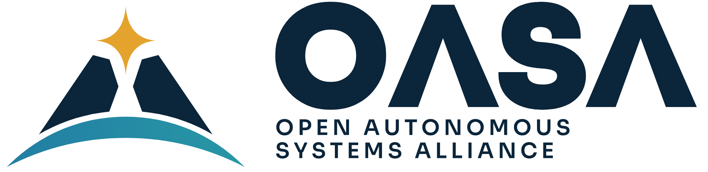

# OASA brand

Logos, colors, icons, patches and art for the [Open Autonomous Systems Alliance](https://joinoasa.org).

**Everything here is a concept for now.** Look around, borrow ideas, and add your own. Nothing is final until it's marked **Official** below.

## What's here

| Folder | What goes in it | Current files | Status |
|---|---|---|---|
| [`guide/`](guide/) | Brand guide: colors, fonts, look and feel | Brand guide v1 | Concept |
| [`logos/wordmark/`](logos/wordmark/) | The OASA name as a logo | OASA wordmark | Concept |
| [`logos/oasa-logo/`](logos/oasa-logo/) | **The OASA logo:** mark, wordmark, vertical and horizontal lockups, app icon and avatar, in full color, on dark and one color | Design 6 (minimal), SVG and PNG | Concept (locked in by the founder, 2026-10-28) |
| [`logos/marks/`](logos/marks/) | Symbols that work without the name (icons, avatars) | Delta, Orbital and Network marks | Concept |
| [`logos/seal/`](logos/seal/) | Round seal for formal use | OASA seal | Concept |
| [`icons/domains/`](icons/domains/) | One icon per domain or tech tree branch | Space, Air, Land, Sea, Underwater | Concept |
| [`icons/system/`](icons/system/) | Project icon system: SVG, full color, one color, white, dark | 18 icons in 4 families | Concept |
| [`patches/`](patches/) | Mission-style patches for projects | Satellite, Flight, Robotics, Clean Oceans, Mesh | Concept |
| [`banners/`](banners/) | Wide art for the website, Discord and social headers | All-domains hero | Concept |
| [`tokens/`](tokens/) | Colors as code, for the website and apps | `colors.css`, `colors.json` | Concept |
| [`documents/`](documents/) | Branded documents (Word, PDF) and their text | Core values one-pager, manifesto | Draft |

## Quick reference

| Color | Hex | Use |
|---|---|---|
| Deep Navy | `#0B253A` | Main brand color, text, dark backgrounds |
| Steel Blue | `#253A66` | Engineering, secondary panels |
| Signal Gold | `#E3A32C` | Highlights, the star, calls to action |
| Mesh Teal | `#2F968A` | Community, connection |
| Aluminum | `#E5E8ED` | Light backgrounds |

Fonts: **Sora** for headings and **Inter** for body text. Both are free and open ([Sora](https://fonts.google.com/specimen/Sora), [Inter](https://fonts.google.com/specimen/Inter)).

Tagline: *Open systems. Shared knowledge. Unlimited frontiers.*

## Look and feel

OASA builds tough, field-ready robots, drones and boats. They can look rugged, like vehicles made for hard conditions.

**No weapons.** No guns, missiles, weapon mounts, targeting or military insignia in any OASA art. Show sensors, antennas, solar panels, cameras and tools instead.

## Contribute

Anyone can suggest or add art. See [CONTRIBUTING.md](CONTRIBUTING.md).

## License

The art here is shared under [CC BY-SA 4.0](LICENSE): you can use and remix it with credit, and share your changes the same way.

The OASA name and logos are not covered by that license. See [TRADEMARKS.md](TRADEMARKS.md).
