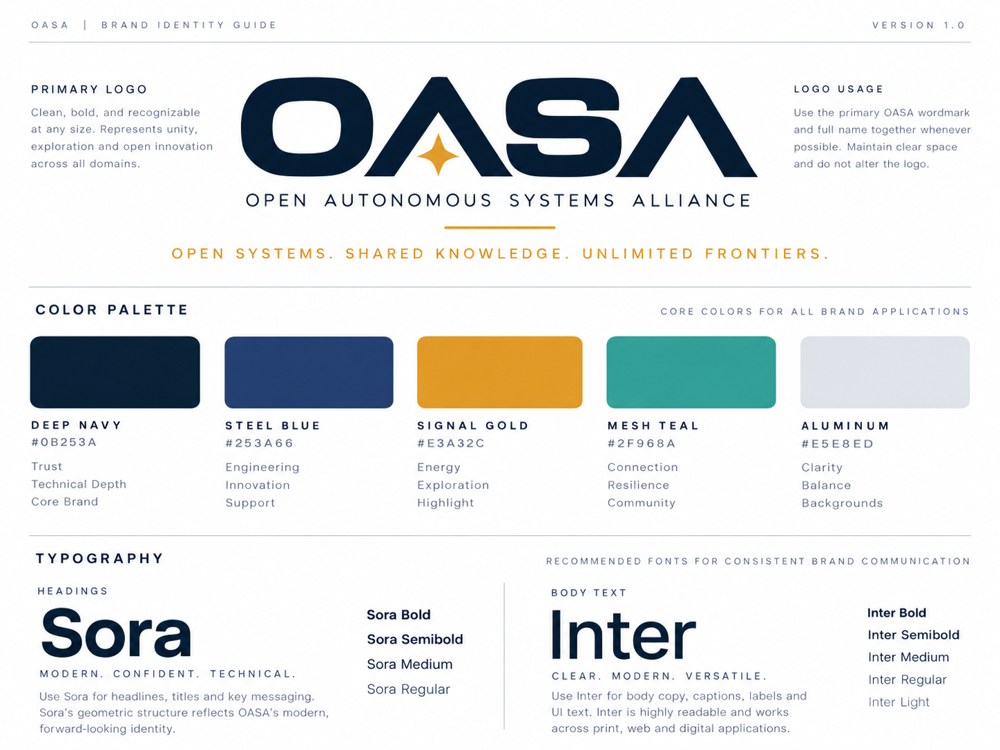

# Brand guide

**Status: concept (v1).**

## Colors

| Name | Hex | Meaning |
|---|---|---|
| Deep Navy | `#0B253A` | Trust, technical depth, core brand |
| Steel Blue | `#253A66` | Engineering, innovation, support |
| Signal Gold | `#E3A32C` | Energy, exploration, highlight |
| Mesh Teal | `#2F968A` | Connection, resilience, community |
| Aluminum | `#E5E8ED` | Clarity, balance, backgrounds |

Use Signal Gold sparingly, for the star and one highlight per layout.

## Fonts

- **Headings:** [Sora](https://fonts.google.com/specimen/Sora) (Bold, Semibold, Medium, Regular)
- **Body and UI:** [Inter](https://fonts.google.com/specimen/Inter) (Bold to Light)

## Logo use

- Use the wordmark with the full name whenever there's room.
- Leave clear space around it, about the height of the "O".
- Don't stretch, recolor or redraw it.
- On dark backgrounds, use the white version with the gold star.

## Look and feel

Rugged, field-ready vehicles are on brand. Weapons are not: show sensors, antennas, solar panels and tools instead.
