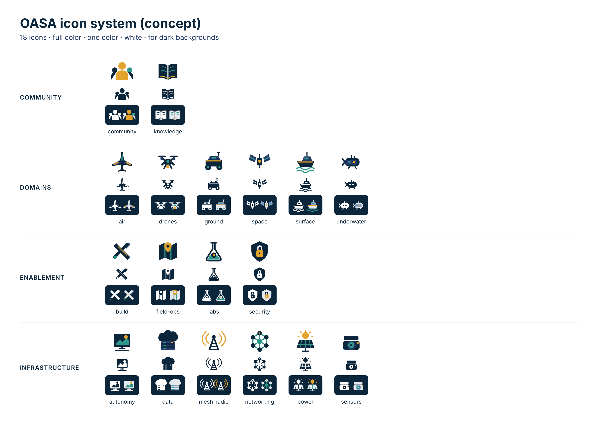

# OASA icon system

**Status:** Concept

18 project icons in four families: domains, infrastructure, enablement and community. They're flat and geometric, drawn on a 64 × 64 grid in the brand colors. These are project icons, not logos: they sit beside the OASA marks and never replace them.



## Files

Each icon comes in four versions:

| File | Use |
|---|---|
| `name.svg` | Full color, on white or Aluminum |
| `name-dark.svg` | Full color, on Deep Navy or other dark backgrounds |
| `name-mono.svg` | One color (Deep Navy). Details are cut out, so the background shows through |
| `name-white.svg` | One color, white, for dark backgrounds |

- Colors are written into every shape, so the files work in browsers, Figma, Inkscape, Illustrator, Word and PDFs.
- Each file has its own title and IDs, so several icons can sit on one page.
- They read down to 24 px. Below that, use the mono version.

| Family | Icons |
|---|---|
| `domains/` | air, drones, ground, space, surface, underwater |
| `infrastructure/` | autonomy, data, mesh-radio, networking, power, sensors |
| `enablement/` | build, field-ops, labs, security |
| `community/` | community, knowledge |

## Known gaps

- **air** has swept wings and a tail that read as a fighter jet. Redraw it as a straight-wing survey drone or a glider.
- **autonomy** reads as "photo gallery". Redraw it as a vehicle following a dotted path of waypoints.
- **build** shrinks to an X at 24 px.

## Making the variants

Edit the full-color icon only. Then regenerate the other three:

```
pip install cairosvg pillow
python3 tools/variants.py <folder of full-color icons> <output folder>
```

The script writes the real colors into each shape and builds the dark version. It also builds the one-color versions: any gold, teal or Aluminum detail that sits on navy becomes a cut-out.

## Credits

The full-color icons were drawn with ChatGPT image and SVG tools in an interactive session led by JC, then cleaned up with `tools/variants.py` (Claude). They're original work, shared under CC BY-SA 4.0 like the rest of this repo.
