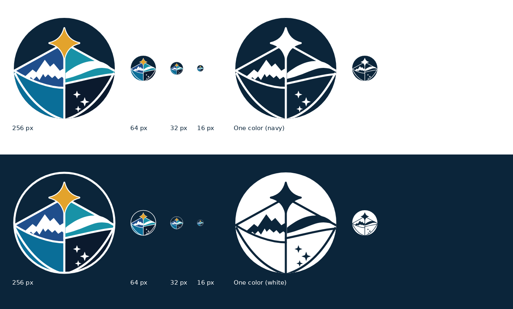

# OASA emblem (Option 7)

**Status: Concept.** Chosen by the founder on 2026-10-28 as the direction to use; not marked Official yet.

One circle that holds every OASA domain: the **guiding star** (exploration), **summit** (land), **wave** (sea), **night sky** (space) and the **ocean** below.

## Files

| File | Use |
|---|---|
| `oasa-emblem.svg` / `.png` | Full color, on white or light backgrounds |
| `oasa-emblem-on-dark.svg` / `.png` | Full color with a white ring, on navy or dark backgrounds |
| `oasa-emblem-navy.svg` / `.png` | One color, navy: stickers, engraving, print, embroidery |
| `oasa-emblem-white.svg` / `.png` | One color, white: on dark photos and dark merch |
| `option-7-concept-sheet.png` | The concept sheet it was redrawn from (AI-generated in ChatGPT) |

SVGs are the source. PNGs are 1024 px exports.

## Colors

The emblem uses the brand colors plus three in-between blues for the scene:

| Part | Hex |
|---|---|
| Field, outline | Deep Navy `#0B253A` |
| Star | Signal Gold `#E3A32C` |
| Summit sky | `#1F4E8C` |
| Wave water | `#1892A7` |
| Ocean | `#0A6E98` |
| Night sky | `#0B1A2E` |
| Lines, snow, wave crest, stars | White `#FFFFFF` |

## Rules

- **Size:** full detail from 48 px up. At 32 px it still reads; at 16 px (favicons) it becomes a colored disc with a gold point.
- **Clear space:** keep at least a quarter of the emblem's width empty around it.
- **Don't** recolor parts, stretch it, add effects (shadows, gradients, glows) or put it on busy photos without the on-dark version.
- **Next to the wordmark:** use the plain OASA wordmark; the star already lives in the emblem.
