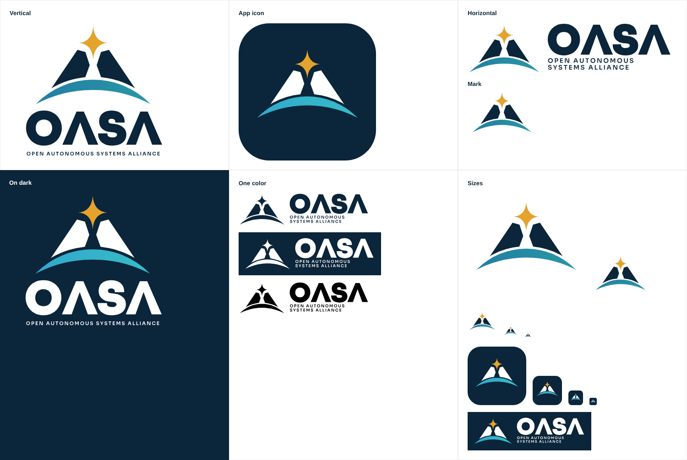

# OASA logo (Design 6, minimal)

**Status: Concept.** Locked in by the founder on 2026-10-28 as the logo to use; not marked Official yet.

A split peak (the **A**, with no crossbar) under a **guiding star**, rising over the **horizon**. Simple flat shapes, so it holds up from a building sign down to a browser tab.

## Files

SVGs are the source; `png/` has exports (logos 2000 px wide, marks 2000 px, square crops 512 px, icons 1024 px).

| File | Use |
|---|---|
| `oasa-logo-vertical.svg` | Primary logo: mark over OASA over the full name |
| `oasa-logo-horizontal.svg` | Mark beside OASA and the name: headers, letterheads, slides |
| `oasa-mark.svg` | The mark alone |
| `oasa-mark-square.svg` | The mark cropped square: favicons, small spots, the email signature |
| `oasa-wordmark.svg` | OASA alone |
| `…-on-dark.svg` | Full color for navy or dark backgrounds (white peak, brighter horizon) |
| `…-navy.svg`, `…-white.svg`, `…-black.svg` | One color: print, engraving, embroidery, stickers |
| `oasa-app-icon.svg` | Navy rounded square: app icons, Discord, social profiles |
| `oasa-avatar.svg` | Full-bleed navy square: profile pictures (safe in a circle crop) |
| `social/` | Ready to upload: `discord-server-icon.png` (512), `github-org-avatar.png` (500), `github-social-preview.png` (1280×640, repo link previews) |
| `design-6-concept-sheet.png` | The concept it was redrawn from (AI-generated in ChatGPT) |
| `source/` | The Python scripts that drew these files (reference; they need the Sora font instances) |

## Colors

| Part | Light backgrounds | Dark backgrounds |
|---|---|---|
| Star | Signal Gold `#E3A32C` | Signal Gold `#E3A32C` |
| Peak | Deep Navy `#0B253A` | White `#FFFFFF` |
| Horizon | `#1F6FA3` → `#2BA6A6` (left to right) | `#2B9FD0` → `#3CC6C4` |
| Wordmark and name | Deep Navy | White |

## Type

- **OASA:** Sora weight 800, slightly heavier still, with crossbar-less A's. Drawn as outlines, so no font is needed.
- **Open Autonomous Systems Alliance:** Sora weight 600, all caps, wide letter spacing.

## Rules

- **Clear space:** at least the height of the star on every side.
- **Minimum size:** logo 32 px tall; mark 16 px (use `oasa-mark-square` or the app icon below 32 px).
- **Don't** recolor parts, rotate, stretch, outline, add shadows or glows, or rearrange the star, peak and horizon.
- On photos, use the on-dark or one-color white version over a calm, dark area.
